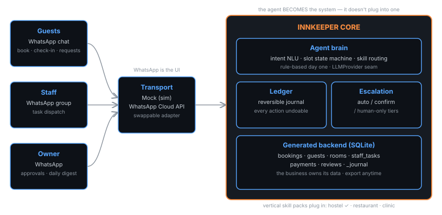

# innkeeper

[](LICENSE)
[](pyproject.toml)
[](https://github.com/habib-analyst/innkeeper)

**The AI innkeeper: the agent that *becomes* your business system.** No PMS, no POS, no problem — on signup it generates your backend (bookings, guests, rooms, staff tasks), runs your whole operation over WhatsApp, and journals every action as a reversible transaction. Built for the ~90% of guest houses, restaurants and clinics that run on WhatsApp and spreadsheets — the businesses every existing AI tool ignores because there's "nothing to integrate with."

## Quickstart

```bash
pip install innkeeper
innkeeper init my-guesthouse --owner-phone +923001234567 --easypaisa 0345-1111111
innkeeper demo --db my-guesthouse.db
```

Real output (simulated WhatsApp, full guest journey in ~30 seconds):

```
🧑 +923001234567: Salam! Do you have a room for 2 people, tomorrow to day after tomorrow?
🏠 innkeeper: ✅ Available 2026-10-12 → 2026-10-13:
• Deluxe 1 (deluxe, 2 guests) — Rs 8500/night
• Standard 1 (double, 2 guests) — Rs 5500/night
Reply "book" + room name to confirm, e.g. "book Deluxe 1".

🧑 +923001234567: book Deluxe 1
🏠 innkeeper: 🎉 Booked! Deluxe 1 (deluxe) — 2026-10-12 → 2026-10-13
1 night(s), 2 guest(s). Total: Rs 8,500
Booking ID: b1b1eab7b
...check-in, housekeeping request, checkout, review nudge all handled...
```

## Measured results

10 scripted end-to-end guest scenarios (inquiry → booking → stay → checkout → review), deterministic rule-based engine, zero LLM calls:

| metric | measured |
|---|---|
| scenarios passed | **10/10** |
| booking conversion (availability → confirmed) | **1.00** |
| escalation-tier accuracy (auto/confirm/human-only) | **1.00** |
| journal reversibility (undo restores exact state) | **3/3 (100%)** |
| response latency p50 / p95 | **0.96 ms / 4.73 ms** |
| double-booking races prevented | **1/1** |
| pytest suite | **21/21 green** |

Honest limits: the day-one brain is rule-based (English + Roman Urdu keywords) — it handles the hostel flows above and fails closed to a human on anything else. The `LLMProvider` seam exists to swap in a free-tier LLM later without touching routing, journaling or escalation. WhatsApp Cloud API adapter is built but needs one-time Meta business verification (a human task) before production.

## How it works



- **Generated backend** — `innkeeper init` creates the business's SQLite system of record (bookings, guests, rooms, staff tasks, payments, reviews). The business owns its data; export anytime. No walled garden.
- **Reversible transaction journal** — every agent action is logged with before/after state and an undo op. `ledger.revert(id)` restores exact prior state. The audit trail is append-only.
- **Escalation tiers** — `auto` (answer, book, dispatch), `confirm` (cancellations, modifications, money movement — owner taps approve in chat), `human_only` (complaints, refunds — owner handles personally). Unknown actions fail closed to `confirm`.
- **WhatsApp as the OS** — guests book in chat, staff get tasks in a group, the owner gets approvals + a daily digest in chat. Mock transport for simulation; WhatsApp Cloud API adapter for production.
- **Vertical skill packs** — `skills/hostel/` today; restaurant and clinic packs plug into the same core.

## Citation

```bibtex
@software{rehman2026innkeeper,
  author = {Rehman, Habib Ur},
  title = {innkeeper: the AI innkeeper — the agent that becomes your business system},
  year = {2026},
  url = {https://github.com/habib-analyst/innkeeper}
}
```

---
Built by [Habib Ur Rehman](https://github.com/habib-analyst) · ML/AI Engineer & healthcare-AI researcher ·
[LinkedIn](https://www.linkedin.com/in/hur-dev) · [habib.top](https://habib.top)
